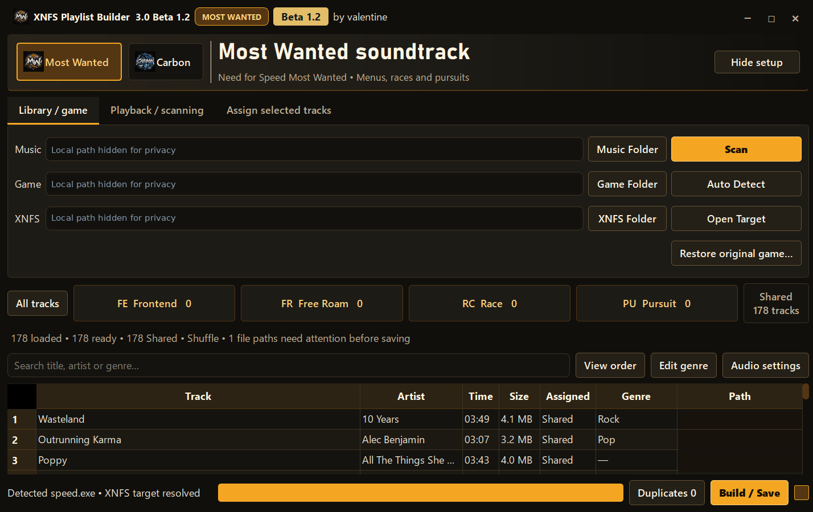

# 🏁 XNFS Playlist Builder

### Your music. Your drive. Your soundtrack.

**Build your own soundtracks for Need for Speed Carbon and Need for Speed Most Wanted (2005).**

**Both games work.** Carbon has car-class music and crew-dialogue ducking. Most Wanted now has automatic driving playlists, in-game skipping, and a much stronger set of features.

  

**[🚗 What can I do?](docs/FEATURES.md)** · **[🚀 How do I install it?](docs/GETTING-STARTED.md)** · **[💬 I need help](docs/TROUBLESHOOTING.md)**

---

> [!IMPORTANT]
> **Version update:** XNFS Playlist Builder **3.2 Beta 1.4** is ready for final release packaging. A Beta 1.4 installer is already available in a previously published GitHub release, but that release has an older **v3.1-beta-1.4** tag. We're preparing a correctly labeled **v3.2-beta.1.4** release with the final cleaned archive and new Most Wanted screenshots.

### 📥 Get the currently published beta

**[⬇️ Download the available Windows installer ZIP](https://github.com/ValentineBSAA/XNFS-Playlist-Builder-/releases/download/v3.1-beta-1.4/XNFS-Playlist-Builder-3.2-Beta-1.4-Clean-Public.zip)** · **[📖 Installation guide](docs/GETTING-STARTED.md)**

For the final cleaned **3.2 Beta 1.4** release, check the [Releases page](https://github.com/ValentineBSAA/XNFS-Playlist-Builder-/releases). Don't download GitHub's automatically generated “Source code” ZIP: it isn't the Windows installer.

## 🎶 What is it?

Imagine driving through Carbon or Rockport with songs you actually chose.

**XNFS Playlist Builder** finds music in a folder on your PC, helps organize it into game-specific playlists, and prepares it for your game. You can use genre suggestions or put every song exactly where you want it.

You do **not** need to write code, edit configuration files by hand, or subscribe to a music service.

## 🎮 Choose your game

|  | 🔵 Carbon (2006) | 🟡 Most Wanted (2005) |
| --- | --- | --- |
| **Custom playlists** | ✅ Yes | ✅ Yes |
| **Soundtrack categories** | Menu, Muscle, Tuner, Exotic | Safe House, Free Roam, Race, Pursuit |
| **Automatic in-game selection** | Follows car class | Follows driving situation |
| **Skip a song** | Optional **F9** | **T** while driving |
| **Shuffle / volume leveling** | Available | Available |
| **Extra option** | Lower music during crew dialogue | EA Trax song notifications |

**Good to know:** In Most Wanted, **Safe House** includes both the game menus and the safe house. There is no separate Menu playlist to set up.

Both games are usable, but installation and gameplay can vary by executable version and existing modifications. Read the [compatibility notes](docs/GAMES-AND-COMPATIBILITY.md) before changing your game.

## 🚀 It's as simple as choosing songs

1. **Download and install the Windows builder.**
2. Choose **Carbon** or **Most Wanted**.
3. Pick your **game folder** and **music folder**, then scan.
4. Review your songs and choose the optional game playback features.
5. With the game closed, select **Build / Save**, then launch your game.

[**📖 First time doing this? Follow the illustrated, beginner-friendly setup guide →**](docs/GETTING-STARTED.md)

> If this is your first game mod, the [setup guide](docs/GETTING-STARTED.md) explains what to back up and why an ASI loader is needed.

## 📷 See the application

### 🔵 Carbon soundtrack editor

*Create playlists for your Menu and the three car classes.*

### 🟡 Most Wanted soundtrack editor

*This image is from the **previous public beta**. Beta 1.4's new Most Wanted screens will be added to the gallery as part of the screenshot update.*

[**📸 Browse the available application screenshots →**](screenshots/README.md)

## ✨ What's new in 3.2 Beta 1.4?

Most Wanted received the biggest upgrade:

**Four automatic soundtracks.** Menu and safe-house music share one **Safe House** group; Free Roam, Race and Pursuit have their own groups.

**Skip without pausing.** Press **T** to move to the next track while driving in Most Wanted. Carbon continues using optional F9 skipping.

**More equal footing.** Most Wanted now includes automatic driving-state routing, optional repeat-aware shuffle, music-leveling copies and EA Trax notifications.

**Safer changes.** Clearer installation status checks, better backup handling, and separate options to restore a saved setup or return to tracked original game files.

[**🏁 Read the full Beta 1.4 change guide →**](docs/WHATS-NEW-BETA-1.4.md)

## 🛡️ Before you modify a game

- Use **Windows 10 or 11, 64-bit**. Bring your own games and music; they are **not** included.
- Make a backup of your game, especially if you already use mods or another XNFS music player.
- For in-game integration you need a **compatible ASI loader** and supported game executable.
- Installing the Windows builder alone does **not** automatically modify your game. Installing game features or saving playlists can.
- **Beta software:** Carbon 1.2 has been tested in-game, while Carbon 1.4 still needs wider game testing. Most Wanted's latest merged menu/safe-house behavior still needs a follow-up live test.
- The installer is **unsigned**, so Windows might display an unknown-publisher warning. Only run software you trust.

## ❤️ Questions, bugs, or ideas?

[**💬 Common questions**](docs/TROUBLESHOOTING.md) · [**🛡️ Backups and restoring**](docs/BACKUPS-AND-RESTORE.md) · [**🐛 Report a problem**](https://github.com/ValentineBSAA/XNFS-Playlist-Builder-/issues/new/choose)

When reporting a problem, tell us your game, game version, Windows version, and what happened. Remove personal paths from screenshots or logs.

---

**Made by valentine** · Original XNFSMusicPlayer by **Lovro Pleše (xan1242)**

Independent fan-made utility. Not affiliated with or endorsed by Electronic Arts. Need for Speed and related trademarks belong to their respective owners.

