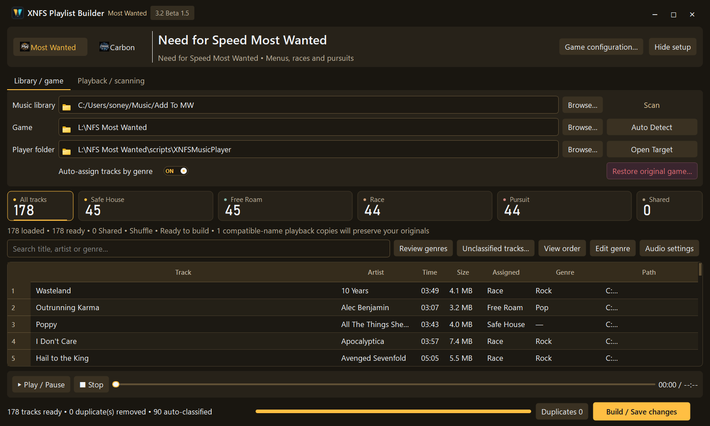
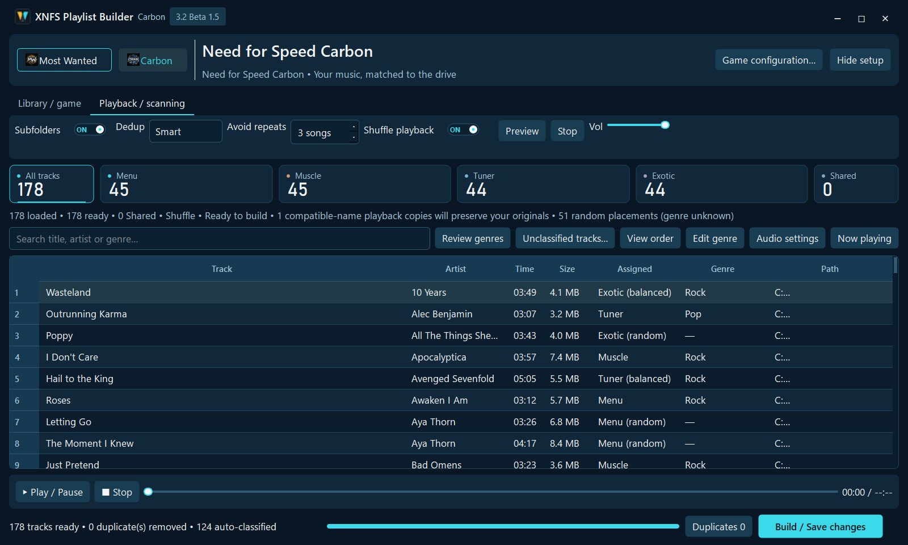

# 🏁 XNFS Playlist Builder
### Your music. Your drive. Your soundtrack.

**A Windows soundtrack studio for Need for Speed: Most Wanted (2005) and Carbon (2006)**

**Windows 10 / 11 x64 · 3.2 Beta 1.6 · Experimental prerelease**

[**⬇️ DOWNLOAD FROM GITHUB RELEASES**](https://github.com/ValentineBSAA/XNFS-Playlist-Builder-/releases) · [**Quick start**](docs/GETTING-STARTED.md) · [**What's tested**](docs/WHATS-NEW-BETA-1.6.md) · [**Screenshots**](screenshots/README.md)

> [!IMPORTANT]
> **Beta 1.6 has meaningful Most Wanted hardware-tested improvements, but it is not a fully verified stable release.** Carbon 1.4 gameplay and experimental event music remain unverified. See the [tested / needs-testing matrix](docs/WHATS-NEW-BETA-1.6.md) before installing. The Beta 1.6 download will appear on [Releases](https://github.com/ValentineBSAA/XNFS-Playlist-Builder-/releases) after its public ZIP is uploaded.

## Make your own soundtrack

Bring your own game and music. Scan local songs, preview playback, edit assignments, choose game-specific playlists, and use the guided installer to deploy the player where supported. No Python or programming knowledge is required.

| **🟡 Most Wanted: Rockport Gold** | **🔵 Carbon: Midnight Cyan** |
| :---: | :---: |
|  |  |
| [Most Wanted guide](docs/MOST-WANTED.md) | [Carbon guide](docs/CARBON.md) |

*The existing Beta 1.5 screenshot gallery remains representative. No new screenshots were added for Beta 1.6.*

## Highlights in Beta 1.6

- **Most Wanted transitions:** adjustable fade-in/fade-out and the option to finish a full song before changing pools.
- **Gameplay listening confirmations:** Safe House fades, prologue music, Free Roam to ordinary Pursuit, custom interactive pursuit songs, **T** skip, EA Trax titles and the revised original-score pursuit exit fade.
- **Independent music mix:** default **65%**, accepted in the tested session alongside engine and police radio. Adjust to your setup.
- **Loudness leveling:** optional target and true-peak ceiling; makes playback copies and preserves originals.
- **Better control:** editable multi-category song assignments, per-game settings and guided install/repair, backup and restoration.
- **Support button:** preview a plain-English or JSON diagnostic report, then save both in one local ZIP. It does not send anything automatically.
- **Carbon support:** Menu, Muscle, Tuner, Exotic and Shared; optional F9 and crew ducking. Player files for inspected Carbon 1.2 / 1.4 executables.

## Games and supported behavior

| | **Most Wanted (2005)** | **Carbon (2006)** |
| --- | --- | --- |
| Pools | Safe House (also menus), Free Roam, Race, Pursuit, Shared | Menu, Muscle, Tuner, Exotic, Shared |
| Routing | Driving state and chosen pursuit mode | Car class and menu |
| Skip | **T** for ordinary/custom continuous music; not original adaptive score | Optional/configurable **F9** |
| Special modes | Original adaptive, custom interactive, or complete-song pursuit playlist | Crew ducking; experimental Canyon, Pursuit, Drift event settings |
| Known limit | Save-switch first track and some custom fade boundaries still need tests | **No independent custom Canyon/Pursuit pools**; 1.4 and event gameplay need tests |

### Tested versus experimental

**In Most Wanted gameplay:** the developer confirmed three Safe House fade excerpts, scripted prologue audibility, ordinary Free Roam/Pursuit switching, custom interactive pursuit with three chosen songs, T skip, EA Trax titles, and the revised original-interactive pursuit-to-Free-Roam fade. The last transition works but can feel slow. This is acceptance of those sessions, **not** a guarantee for every game version, save or mod combination.

**In Carbon:** earlier 1.2 gameplay confirmed car-class routing, F9 skipping and speech ducking. Both 1.2 and 1.4 installer payloads passed isolated checks. **1.4 gameplay, Canyon/Pursuit/Drift event playback and the intermittent Load Complete crash remain open.**

**Still unverified:** actual PLAK gameplay despite compatible Most Wanted hook signatures; first song after switching saves; revised custom-mode exit-fade retest; fade-in at every natural custom song boundary; the rendering issue observed on a heavily modified Most Wanted installation.

[Read the detailed Beta 1.6 evidence and limitations](docs/WHATS-NEW-BETA-1.6.md).

## Five-step installation

1. Visit [GitHub Releases](https://github.com/ValentineBSAA/XNFS-Playlist-Builder-/releases) and download **`XNFS-Playlist-Builder-3.2-Beta-1.6-Public.zip`** when published, not the automatic GitHub Source code ZIP.
2. Extract it and run **`XNFS-Playlist-Builder-3.2-Beta-1.6-Setup.exe`** on Windows 10/11 x64. The installer is unsigned.
3. Select your Most Wanted or Carbon game folder and your own music library, then scan and review assignments.
4. With the game **closed**, open **Game configuration → Installation**. Check setup, choose required player features and review changes. A compatible **ASI loader** must already be present.
5. Use **Build / Save**, launch the game, and check relevant music states.

Installing the desktop builder alone does not modify a game. Installing player features or writing playlists **can**. Keep an independent backup of your entire game folder. Uninstalling the desktop builder does not revert game changes.

[Complete setup instructions](docs/GETTING-STARTED.md) · [Restoring backups](docs/BACKUPS-AND-RESTORE.md).

## Support and documentation

The new **Support** button generates a local, reviewable ZIP with `diagnostics.txt` and `diagnostics.json`. It intentionally excludes raw logs, personal paths, song titles, music and saves. Review any other attachments before sharing them.

[Report an issue](https://github.com/ValentineBSAA/XNFS-Playlist-Builder-/issues/new/choose) · [Discussions](https://github.com/ValentineBSAA/XNFS-Playlist-Builder-/discussions) · [Troubleshooting](docs/TROUBLESHOOTING.md) · [SHA-256](docs/SHA256-OF-BETA-1.6.txt) · [Licensing and credits](docs/LICENSING-AND-CREDITS.md).

For features, installation, compatibility, technical notes and historical Beta 1.5 disclosures, visit the [documentation index](docs/README.md). The [screenshots](screenshots/README.md) are retained from Beta 1.5.

> [!NOTE]
> GitHub's automatically generated **Source code** archives contain this documentation-and-screenshots repository, **not the Windows application or the editable developer source**. Download the **Public ZIP** release asset for the Windows program.

---

Created by **valentine** · Original XNFSMusicPlayer and native in-game installer by **Lovro Pleše (xan1242)**.

Independent fan-made tool, not affiliated with or endorsed by Electronic Arts. No commercial game or music assets included.

