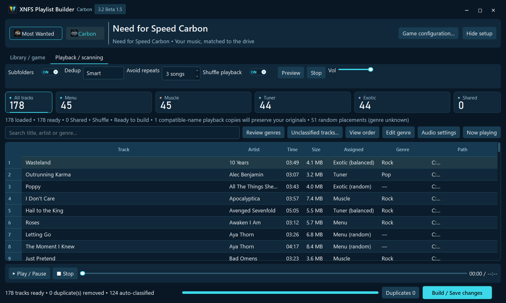
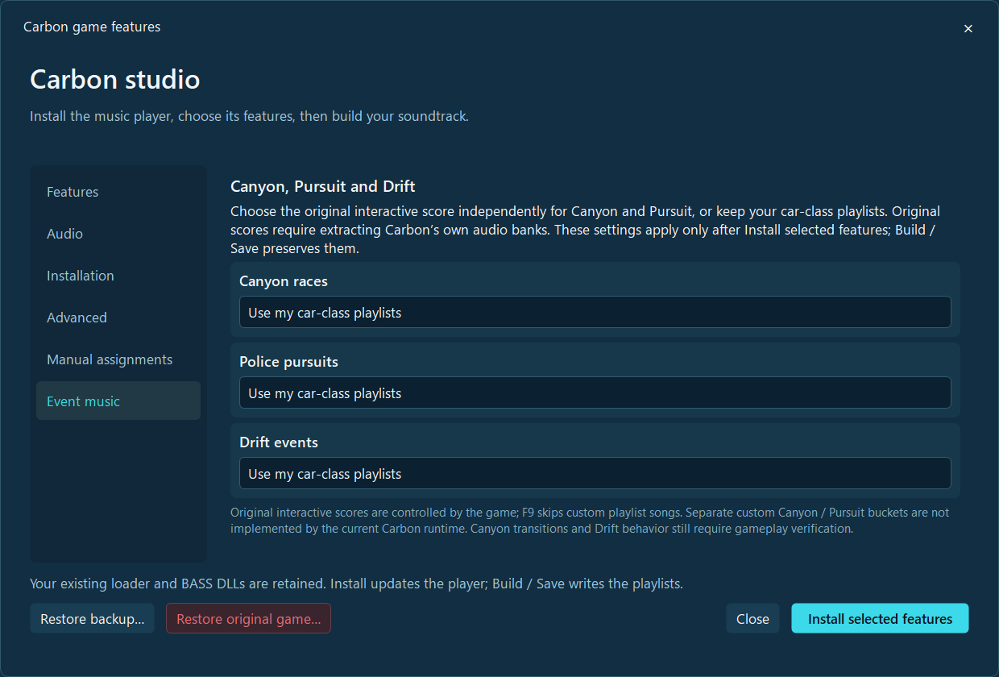

# 🔵 Carbon (2006): Midnight Cyan

[← Home](../README.md) · [Setup guide](GETTING-STARTED.md) · [Beta 1.7 test matrix](WHATS-NEW-BETA-1.7.md)

## Soundtracks for each car class

| Category | Music use | Example metadata preference |
| --- | --- | --- |
| **Menu** | Frontend and menus | Any |
| **Muscle** | Muscle-class cars | Rock / alternative |
| **Tuner** | Tuner-class cars | Electronic / pop |
| **Exotic** | Exotic-class cars | Hip-hop / rap / grime |
| **Shared** | Fallback | Any |

The automatic placement system is metadata-based, not waveform genre detection. Manual assignments provide exact control. There is no artificial playlist length cap.

## What is known to work

Earlier **Carbon 1.2 gameplay** confirmed car-class music switching, optional/configurable **F9** skipping and optional music ducking around crew speech. The builder retains separate Carbon settings and editable audio balance controls. Ducking should **not** silently turn itself on if the saved setting is OFF.

Installer payloads exist for the inspected **Carbon 1.2 and 1.4** executables; isolated installation checks passed, **but complete Carbon 1.4 gameplay has not**. The Developer ZIP for Beta 1.7 includes packaged game-view checks but explicitly states that the **final EXE was not gameplay-tested**.

## Canyon, Pursuit and Drift are experimental

Configuration choices for original Canyon and Pursuit scoring and Drift playlist/original ambience/silent options exist, but their **event-by-event real playback remains unverified**. **Independent custom Canyon and custom Pursuit track buckets are not implemented**; custom event choices still rely on class-based pools.

The original-score extraction is experimental and should not be equated with Most Wanted's game-side original score extraction flow.

## Remaining crash investigation

An intermittent game crash around **Load Complete** has been reported. Its root cause is **unverified**, and it has **not** been established that XNFS causes it. Do not describe the Windows installer upgrade fix as a fix for the Carbon game-side crash.

Beta 1.7 improves shared installation progress, completion review and Windows app identity; these gains are not proof of new Carbon 1.4 gameplay compatibility.

[Compatibility](GAMES-AND-COMPATIBILITY.md) · [Test record](WHATS-NEW-BETA-1.7.md) · [Troubleshooting](TROUBLESHOOTING.md)
