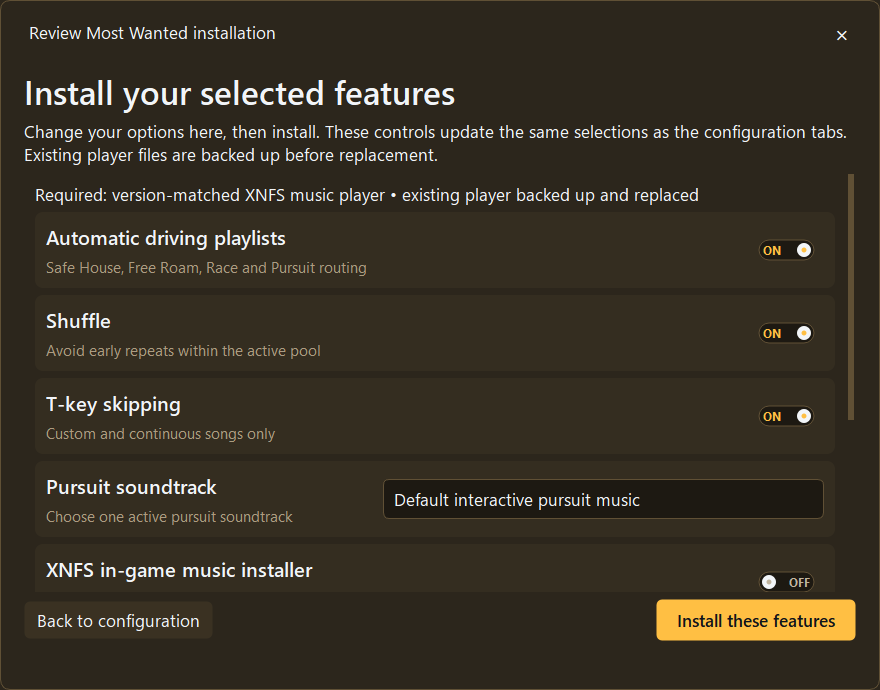

# 🚀 Get started with XNFS Playlist Builder 3.2 Beta 1.6

[← Home](../README.md) · [Download releases](https://github.com/ValentineBSAA/XNFS-Playlist-Builder-/releases) · [Help](TROUBLESHOOTING.md)

> [!WARNING]
> Beta 1.6 remains **experimental**. Back up the complete game folder first. Some compatibility and Carbon event scenarios have **not** been accepted in gameplay.

## Before you start

Use **Windows 10/11 x64** and supply your own legally obtained Most Wanted (2005) or Carbon (2006) installation and music library. In-game integration needs a **compatible existing ASI loader**. The builder will not silently replace an unknown third-party proxy loader. Close the game before installing features or writing playlists.

### 1. Download and install the Windows app

From [GitHub Releases](https://github.com/ValentineBSAA/XNFS-Playlist-Builder-/releases), select **`XNFS-Playlist-Builder-3.2-Beta-1.6-Public.zip`** once the prerelease is posted. Extract the ZIP and run **`XNFS-Playlist-Builder-3.2-Beta-1.6-Setup.exe`**. It is an unsigned Windows installer, so check the origin and [SHA-256](SHA256-OF-BETA-1.6.txt). No Python installation is needed.

**Do not download the automatic GitHub Source code ZIP to install Windows software.** Those archives contain documentation and screenshots, not the compiled app. The Developer ZIP is not the public installer.

### 2. Choose your game and folders

Select **Most Wanted** (gold theme) or **Carbon** (cyan theme). Locate the game folder, your music library and any required player location. Verify Auto Detect before relying on it. Each game's settings are kept separately.

### 3. Scan and assign music

Scan your music. Review metadata-based category suggestions and use **Game configuration → Manual assignments** for direct per-track multi-category choices. Click **Save assignments** before using **Build / Save**. Automatic balancing is only a suggestion, not an audio genre detector.

Most Wanted pools: **Safe House (also frontend menus), Free Roam, Race, Pursuit, Shared**. Carbon pools: **Menu, Muscle, Tuner, Exotic, Shared**.

### 4. Review player options and install features

With the game closed, open **Game configuration → Installation → Check setup**. Review editable installation options and file replacement warnings before choosing **Install selected features**. Keep your own original game backup.

**Most Wanted original adaptive soundtrack:** enable the original interactive option, install the native components and **then launch the game**. The native **in-game installer** extracts your own soundtrack assets and shows progress. It is not performed separately inside the Windows builder. This original score is **not T-skippable**.

**Most Wanted custom/ordinary music:** choose the appropriate pursuit mode and library tracks. **T** skips ordinary/custom continuous tracks; original and custom interactive modes should not be combined. Set the independent music volume for your audio mix (Beta 1.6 defaults to 65%).

**Carbon:** choose class pools, optional **F9** skip and crew audio options. Carbon 1.4 game playback and original Canyon/Pursuit/Drift event options remain unverified. Custom event buckets for Canyon/Pursuit are not implemented.

### 5. Build, save and test

Use **Build / Save** to write the chosen playlists while the game is closed, then launch it. Loudness leveling, when enabled, prepares separate audio copies. Test the relevant music context, not just the installer status screen. Never assume a successful file write guarantees correct in-game sound.

## Need help?

Use the **Support** button to preview Plain English/JSON details and save a single diagnostic ZIP for an issue. You decide whether to attach it. For missing playback, return to **Check setup** rather than blindly reinstalling. Do not post unredacted raw logs.

[Known tests and limits](WHATS-NEW-BETA-1.6.md) · [Restore guide](BACKUPS-AND-RESTORE.md) · [Open a bug report](https://github.com/ValentineBSAA/XNFS-Playlist-Builder-/issues/new/choose)
