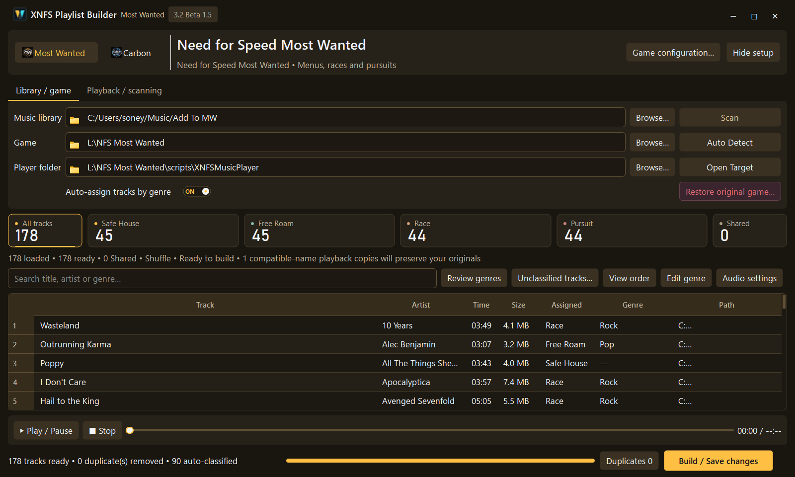
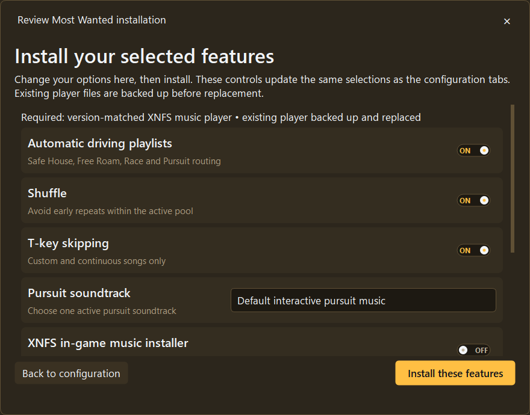

# 🚀 First-time setup: your own soundtrack in five steps

[← Home](../README.md) · [Download Beta 1.5](https://github.com/ValentineBSAA/XNFS-Playlist-Builder-/releases/download/Beta-1.5/XNFS-Playlist-Builder-3.2-Beta-1.5-Public.zip) · [Pictures](../screenshots/README.md)

**XNFS Playlist Builder 3.2 Beta 1.5** creates custom playlists for **Most Wanted (2005)** and **Carbon (2006)**. You don't need to know programming.

> [!WARNING]
> **Beta 1.5 is an experimental prerelease.** Back up your game folder before making changes. Do not assume every in-game feature has been freshly tested. [Current known limits](WHATS-NEW-BETA-1.5.md).

## Before you begin

You need **Windows 10 or 11 (64-bit)**, your own copy of one of the supported games, local music files, and a **compatible ASI loader** for game integration. An ASI loader is a component that allows compatible mods to load in a game. The builder helps check your setup but does **not** automatically replace an unknown third-party loader. **Close the game** before player installation or playlist writes.

## 1. Download the correct ZIP

[**⬇️ XNFS Playlist Builder 3.2 Beta 1.5 (Windows public package)**](https://github.com/ValentineBSAA/XNFS-Playlist-Builder-/releases/download/Beta-1.5/XNFS-Playlist-Builder-3.2-Beta-1.5-Public.zip)

The file name is `XNFS-Playlist-Builder-3.2-Beta-1.5-Public.zip`. Use Windows **Extract All** and run **`XNFS-Playlist-Builder-3.2-Beta-1.5-Setup.exe`** from inside the extracted folder.

- The setup is currently **unsigned**, so Windows may ask you to verify the publisher. Use only the release linked above if you trust it.
- The other ZIP named **GitHub.Screenshots.zip** is a temporary gallery handoff, **not the installer**.
- GitHub's automatically generated **Source code (zip/tar.gz)** downloads are repository snapshots of docs/screenshots, **not the application or editable source project**.
- The application does **not** require Python.

## 2. Choose your game and folders

Choose **Most Wanted** (gold) or **Carbon** (cyan). Use the Library/game setup section to select your **Game**, **Music library**, and any required XNFS/player folder. Auto Detect is available where supported, but **check the result** before trusting it.

## 3. Scan songs and review your categories

Click **Scan**. Track titles and genres come from available metadata; the app does **not** listen to waveforms to identify music genres.

| Most Wanted | Carbon |
| --- | --- |
| **Safe House** (also game menus) | **Menu** |
| **Free Roam** | **Muscle** |
| **Race** | **Tuner** |
| **Pursuit** | **Exotic** |
| **Shared** fallback | **Shared** fallback |

Automatic assignments balance tracks, including unknown genres. Review suggested placements; use **Game configuration → Manual assignments** to switch categories per song, then **Save assignments**. When manual edits are saved, automatic assignment turns OFF to protect your choices. Choose **Build / Save** later to write the game playlists.

## 4. Review optional game-player features

Open **Game configuration → Installation**, use **Check setup**, then choose **Install / repair player** or **Install selected features** as appropriate. Review all options and the replacement warning before committing any game-file changes. A compatible ASI loader remains your responsibility; do not overwrite existing proxy DLLs without checking them.

**Most Wanted original pursuit soundtrack:** choose **Install original interactive music** and install the selected feature. Then launch Most Wanted. The **native in-game installer** extracts your own soundtrack, showing progress and estimated time by stage. It may close the game after completion, so start it again. **Do not expect the Windows builder itself to extract the original score.**

**Most Wanted custom pursuit:** choose a custom mode and songs from your scanned library. Original/native and custom mode should not be played together. The **T** key skips ordinary/custom continuous songs but **not** the original adaptive score.

**Carbon:** car-class music, optional **F9** skip and optional crew music ducking can be configured. Original Canyon/Pursuit and Drift modes are experimental; custom Canyon/Pursuit-specific track buckets aren't implemented. Carbon 1.4 needs full gameplay verification.

## 5. Save and check in your game

With the game closed, click **Build / Save** in the main window. Read the save receipt. If optional loudness leveling is enabled, it prepares **separate playback copies**, not destructive changes to your original music. Launch the game and test each relevant state.

**If the builder closes unexpectedly:** open it again, go to **Game configuration → Installation → Check setup**, and check **Open troubleshooting logs**. Do not immediately reinstall over a possibly successful previous file commit.

## Backups matter

**Restore backup** returns to a prior tracked setup. **Restore original game** previews a return to the recorded original. Both rely on intact records and neither is guaranteed when other modifications have changed files. Complete restore coverage for files created by the native in-game original-audio extractor still needs an end-to-end test.

[Restoration details](BACKUPS-AND-RESTORE.md) · [Troubleshooting](TROUBLESHOOTING.md) · [Full status](WHATS-NEW-BETA-1.5.md)
