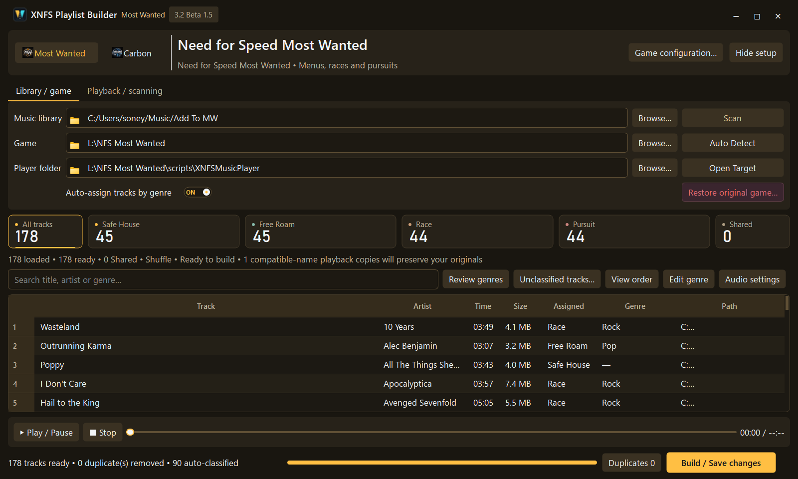

# 🚀 First-time setup | 3.2 Beta 1.7

[← Home](../README.md) · [Releases](https://github.com/ValentineBSAA/XNFS-Playlist-Builder-/releases) · [Tests and limitations](WHATS-NEW-BETA-1.7.md)

> [!WARNING]
> **Experimental public beta.** Keep an independent backup of the complete game folder, including existing mods and XNFS files, before installing game-side components.

### Before installation

You need **Windows 10/11 x64**, a legally obtained **Need for Speed: Most Wanted (2005)** or **Carbon (2006)** installation, your own music files and a compatible **existing ASI loader**. The setup manager checks compatibility but does not silently overwrite an unknown third-party loader/proxy.

### 1. Download the correct file

After it is uploaded, download **`XNFS-Playlist-Builder-3.2-Beta-1.7-Public.zip`** from [Releases](https://github.com/ValentineBSAA/XNFS-Playlist-Builder-/releases). Extract it with Windows **Extract All** and run **`XNFS-Playlist-Builder-3.2-Beta-1.7-Setup.exe`**.

The installer is **unsigned** and does not require you to install Python. See [SHA-256](SHA256-OF-BETA-1.7.txt) to check the download. Automatic GitHub **Source code** archives are *documentation snapshots*, not the installer. The separate Developer ZIP is not the public package.

### 2. Choose the game and music folders

Choose Most Wanted (gold) or Carbon (cyan). Point the builder to the installed game directory and your music library. Check the game executable and any auto-detected folder before continuing. Game/profile preferences remain separate.

### 3. Scan and review songs

Scan the music library and inspect suggested categories. Genre-based placement is approximate, not waveform recognition. Use **Game configuration → Manual assignments** to place songs in multiple appropriate pools, then **Save assignments**. **Build / Save** is a separate game-playlist write operation.

| Most Wanted | Carbon |
| --- | --- |
| Safe House (also menus), Free Roam, Race, Pursuit, Shared | Menu, Muscle, Tuner, Exotic, Shared |

### 4. Install the selected game-side features

**Close the game first.** Go to **Game configuration → Installation → Check setup** and review your chosen player options, backup details and replacement warning. Install only the components you want.

**Most Wanted original interactive music:** enable the native original installer; on game startup, extraction of the **user's own game audio** takes place **inside Most Wanted**, with stages/progress. The Windows builder does not itself extract that native score.

**Most Wanted custom music:** choose ordinary/custom mode, songs and fading options. T skips ordinary/custom continuous music but **not** original adaptive score nodes.

**Carbon:** choose Menu/Muscle/Tuner/Exotic categories and optional F9 / crew ducking. Version-matched inspected 1.2/1.4 installer payloads are available, but 1.4 gameplay and event soundtrack choices need verification.

**New in Beta 1.7:** per-song leveling/analysis progress, item count, named post-audio install stages and an ETA when timing is available. After the completion review, choose **OK** to return to the main workspace.

### 5. Balance music, save and test in game

Use **Build / Save** while the game is closed, launch it and test relevant music states. Most Wanted's independent **Music** level defaults to 65%, but that does not control engine audio.

**Developer-verified requirement:** change the **car engine sound volume manually** using **Most Wanted → Audio options → Car Volume**, adjusting it relative to your music. This is the correct procedure and **not an outstanding feature test**.

The developer reported successful playback tests with **45 custom Pursuit songs**, **45 Safe House songs** and **45 Free Roam songs**. **Subsequent November 13 PC verification:** all personally exercised Beta 1.7 features also worked on **Windows 11 / Most Wanted Black Edition 1.3**. This is a configuration-specific developer confirmation, not a guarantee for every executable. See [hardware test record](PC-VALIDATION-BETA-1.7.md).

## If an older installation fails

A previous Windows upgrade could leave conflicting runtime DLLs and produce a **Shiboken** error. The Beta 1.7 handoff reports that the versioned-runtime fix and an in-place repair completed successfully. Close the error and run the current Setup EXE over the existing app installation. Preserve your game backup and inspect **Check setup** before reinstalling game components.

Use **Support → Save ZIP** for a local diagnostics bundle with a reviewed Plain English/JSON report. It is **not automatically uploaded**.

[Backups](BACKUPS-AND-RESTORE.md) · [Troubleshooting](TROUBLESHOOTING.md) · [Tested versus untested](WHATS-NEW-BETA-1.7.md)
