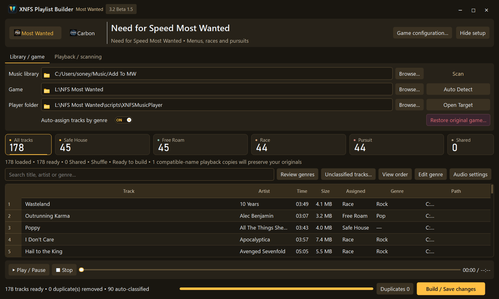
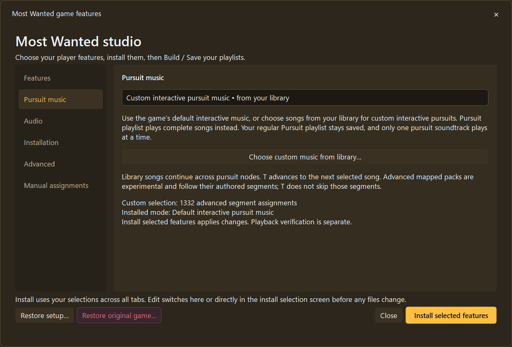

# 🟡 Most Wanted (2005): Rockport Gold

[← Home](../README.md) · [Get started](GETTING-STARTED.md) · [Beta 1.6 test record](WHATS-NEW-BETA-1.6.md)

## Music pools

| Pool | When |
| --- | --- |
| **Safe House** | Safe House **and** frontend menus |
| **Free Roam** | Driving around Rockport |
| **Race** | Racing |
| **Pursuit** | Police pursuits when ordinary playlist mode is active |
| **Shared** | Fallback music |

Songs may belong to multiple pools. Auto assignment uses metadata, not acoustic analysis. Inspect Manual assignments for precise control.

## Three distinct pursuit modes

**Game configuration → Pursuit music** lets you choose *one* of the ordinary Pursuit playlist, original native adaptive score or custom interactive library playback.

- **Ordinary Pursuit playlist:** normal full songs assigned to the Pursuit pool. Beta 1.6 supports finishing the current song before switching pools and configurable fades. A real session confirmed Free Roam to ordinary Pursuit after the prior song ended.
- **Original interactive score:** enable its native installer in **Game configuration → Installation**. The game, **not** the builder, extracts original score audio from your own assets during its native first-run setup. This adaptive score has original timing and cannot be skipped by **T**.
- **Custom interactive music:** choose your own songs from the library. Developer gameplay heard three selected songs and confirmed **T** skipping and corrected **EA Trax** titles. Advanced node maps, segment editing and authored packs remain experimental.

## New fade and balance behavior

The independent music mix defaults to **65%**, accepted during a session where music, engine and police radio were all audible. Adjust to preference; loudness leveling can prepare normalized copies without changing originals.

Beta 1.6 listening confirmed the **first three Safe House fades**, audible prologue soundtrack, ordinary Free Roam/Pursuit selection, custom interactive playback, and revised **original-score pursuit → Free Roam fade-out/fade-in**. The exit timing may still feel slow.

## Tests that are still open

- The **latest custom-interactive** exit-fade change has not had a separate in-game retest.
- Fade-in at **every natural custom-song boundary** remains unconfirmed, even though isolated BASS fade checks passed.
- The **first selected track after switching saved games** still needs a complete gameplay check.
- Long pursuits, different game/mod configurations and complete native-generated soundtrack restoration need more coverage.
- The installer now accepts modified `speed.exe` when **61 music-hook signatures** match; **actual PLAK gameplay remains unverified**.
- A disappearing/misrendered car body was observed on one heavily modified Most Wanted setup. Its cause was **not established** and no graphics files or flags were modified.
- **Police-radio ducking is not implemented**.

Beta 1.4's historical complete-interactive claim was inaccurate; see the [archived disclosure](WHATS-NEW-BETA-1.4.md). Beta 1.6's specific gameplay acceptance does not rewrite earlier versions' histories.

[Compatibility](GAMES-AND-COMPATIBILITY.md) · [Technical notes](TECHNICAL-NOTES.md) · [Troubleshooting](TROUBLESHOOTING.md)
