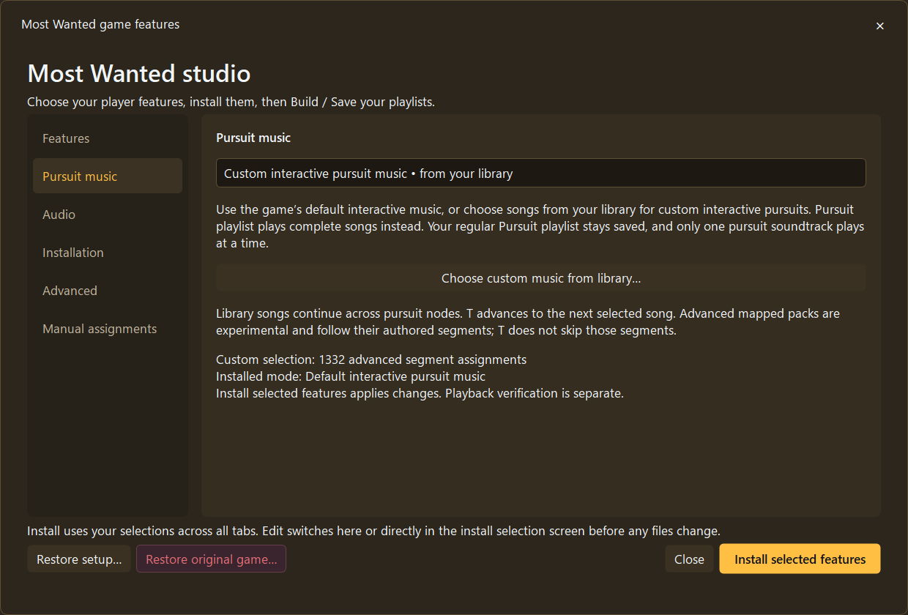
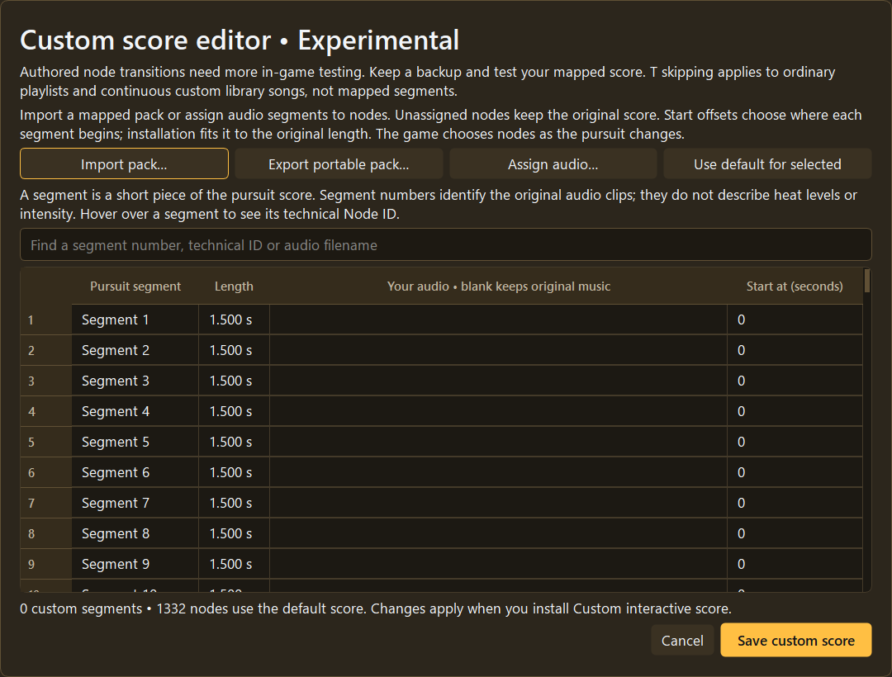

# 🟡 Most Wanted (2005): Rockport Gold

**Build your own Rockport soundtrack with XNFS Playlist Builder 3.2 Beta 1.5.**

[← Home](../README.md) · [Install](GETTING-STARTED.md) · [All photos](../screenshots/README.md)

## Where the songs play

| Pool | Use |
| --- | --- |
| **Safe House** | Frontend menus **and** the safe house; there's no second Menu bucket |
| **Free Roam** | Driving around Rockport |
| **Race** | Races |
| **Pursuit** | Police chases, according to the selected music mode |
| **Shared** | Fallback |

You can assign songs manually to multiple driving categories, or use metadata-based automatic placement. **Shared** is fallback, not a fifth driving state.

## Original score, custom score and normal playlists

The **Game configuration → Pursuit music** page separates original/default interactive audio, custom interactive music from your library, and the ordinary pursuit playlist. Choose **one mode at a time**.

**Original game score:** in **Game configuration → Installation**, choose **Install original interactive music** and **Install selected features**. The builder installs/arms the native ASI. **The game itself** extracts/decodes/encodes your own original soundtrack banks on first run, displaying percent and stage ETA. After its completion and game exit, launch it again. You need valid original game audio and node files. The builder must not run a separate copy of this extraction process.

**Custom interactive pursuit:** select songs from your scanned library. Advanced mapped segments and pack import/export are optional experimental tools. Song playlists and mode settings are retained across mode changes, but extended transitions and overlap still need real listening tests.

**T-key skipping:** confirmed previously for installed ordinary/custom continuous playback while driving; it does **not** skip the native original adaptive score or mapped original nodes. **No F9 requirement for Most Wanted.**

**EA Trax notifications:** previously confirmed; occasional late notifications were observed historically and are not claimed fully fixed.

## What is actually confirmed?

Earlier developer game sessions confirmed situation-based music, original interactive pursuit playback, in-game original soundtrack installer completion, custom pursuit music and custom track skipping. **Those are not a new complete Beta 1.5 regression of Safe House/Free Roam/Race/Pursuit and all transitions.**

**Still to test:** sustained police pursuits; authored segment transitions; original-vs-custom overlap; exit to ordinary music and menus; save/reopen persistence; clean native extraction and restore. **Most Wanted police-radio ducking is not implemented.**

## More Beta 1.5 screens

| Player features | Experimental score mapping |
| :---: | :---: |
|  |  |
| [Manual assignments](../screenshots/beta-1.5/most-wanted/17-manual-assignments.png) | [Installation details](../screenshots/beta-1.5/most-wanted/12-installation-details.png) |

> **Historical Beta 1.4 clarification:** the earlier public Beta 1.4 download did **not** include a completed full interactive pursuit system. Beta 1.5 is a new experimental implementation; earlier in-game acceptance now exists for its original and custom paths, but final regression remains pending. [Read historical Beta 1.4 disclosure](WHATS-NEW-BETA-1.4.md).

[Game comparison](GAMES-AND-COMPATIBILITY.md) · [Current tests and known issues](WHATS-NEW-BETA-1.5.md) · [Help](TROUBLESHOOTING.md)
