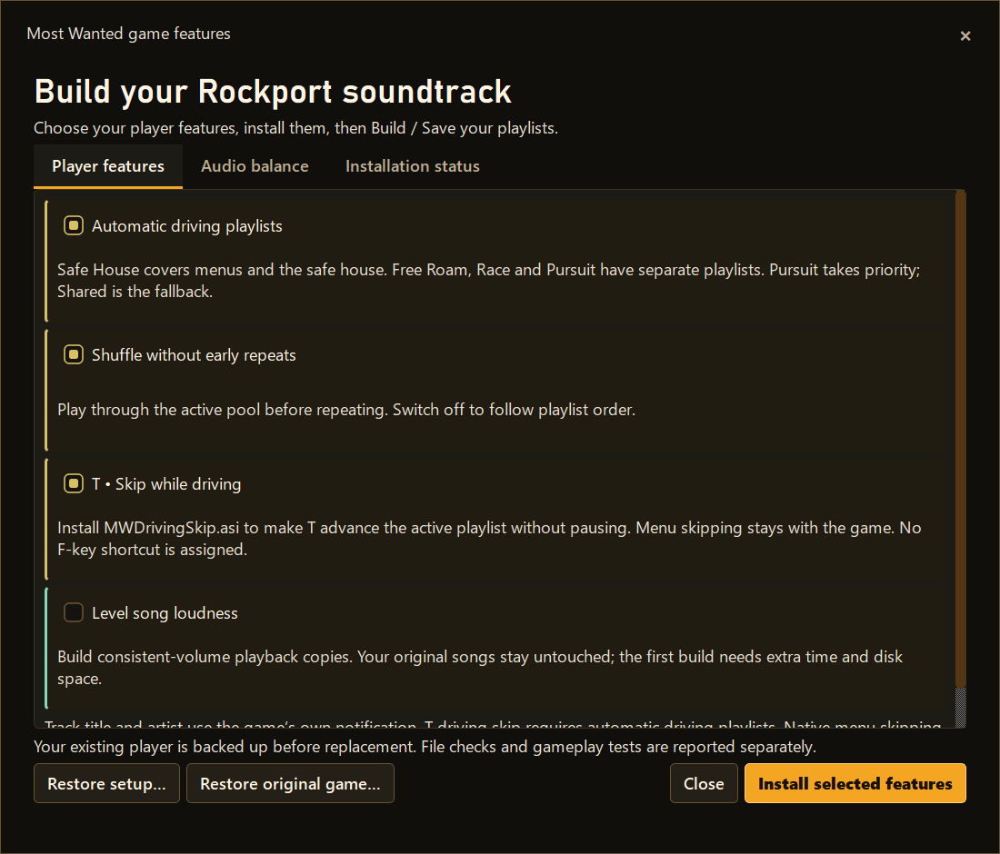

# 🏁 What's new in 3.2 Beta 1.4?

**The biggest change: Most Wanted has caught up significantly with Carbon.** Both games offer custom music tools while keeping their own identity, but not every in-game feature is finished or verified.

[← Home](../README.md) · [⬇️ Download](https://github.com/ValentineBSAA/XNFS-Playlist-Builder-/releases/download/v3.2-beta.1.4/XNFS-Playlist-Builder-3.2-Beta-1.4-Clean-Public.zip) · [See the new Most Wanted screenshots](MOST-WANTED.md)

## Known issue: interactive pursuit music

**Clarification for public 3.2 Beta 1.4 (October 14, 2026):** The **complete interactive pursuit-music system was never fully implemented in Beta 1.4** for Need for Speed Most Wanted (2005). The builder lets you create and edit a **Pursuit** playlist, and some supporting playback groundwork exists, but the full interactive behavior was not completed or integrated as a working feature. **This is unfinished functionality, not a previously working feature that broke.** Please do not download Beta 1.4 expecting fully functional interactive pursuit music.

Completing the missing interactive implementation is being addressed as part of **Beta 1.5 development**. **Beta 1.5 is not ready for release**, and no release date is being promised here. This does not mean that the entire builder or every other music feature is broken.

**A message from the sole developer:** I apologize for describing interactive pursuit music as if it was already working in Beta 1.4 when its full implementation was not actually included. As the sole developer, I test the features and setups available to me, but I cannot cover every gameplay condition, computer, or mod combination. That is a limitation, not an excuse for inaccurate release documentation. I should have clearly separated **implemented and tested**, **partially implemented**, and **planned** features. Thank you to Kronos and everyone reporting issues and helping me improve the project.

## 🟡 Most Wanted: a major upgrade

**Four playlist categories.** Safe House (including menus), Free Roam, Race and Pursuit. **The full interactive Pursuit system was never implemented in Beta 1.4**, despite the category appearing in the editor.

**T to skip songs.** Move to the next song while driving, without opening the pause menu.

**More playback options.** Shuffle that avoids early repeats, optional leveled music copies, automatic genre suggestions and manual playlist organization.

**EA Trax notifications.** Display supported song details as in-game notifications.

**Improved installation and recovery.** Better player status checks, backups for compatible existing setups, and clearer original-game restoration.

**Testing note:** Earlier Most Wanted playback routing, T skipping and restoration were tested by the developer. This is limited testing; **interactive pursuit music was not fully implemented in this release**. The latest change merging menus into Safe House still needs a new live-game test.

## 🔵 Carbon: the car-class specialist

- Menu, Muscle, Tuner and Exotic soundtracks.
- Automatic playlist selection based on your car class.
- Optional F9 skipping and shuffle with repeat protection.
- Optional music-volume leveling.
- Optional lowering of music during crew dialogue.

[**See Carbon's feature options**](CARBON.md)

## ❤️ Improvements across the builder

- More convenient scanning and organization of your own music.
- Genre suggestions, manual editing and unclassified-song review.
- Playlist ordering, track counts and no fixed track limit.
- Optional music leveling that preserves original recordings.
- Better setup checks, status information, and restoring tracked changes.

## Incomplete features and ongoing testing

- The newest Most Wanted menu/Safe House behavior still needs further testing.
- **Not fully implemented in Beta 1.4:** Most Wanted interactive pursuit music. Completing it is part of unreleased Beta 1.5 development.
- Carbon 1.4 live gameplay.
- Compatibility with additional PCs and mod configurations.

**Most Wanted police-radio music ducking is not included in Beta 1.4.** This is a separate feature from interactive pursuit music.

[**Need help?**](TROUBLESHOOTING.md) · [**Report a test result**](https://github.com/ValentineBSAA/XNFS-Playlist-Builder-/issues/new/choose)
