# 📷 XNFS Playlist Builder 3.2 Beta 1.5: real screenshot gallery

**45 actual application screenshots** from the redesigned **Hybrid Performance Studio**: **24 Most Wanted** and **21 Carbon**. The source screens were captured with the 178-track test library and copied settings. **Screenshots demonstrate UI, not proof of game-event playback.**

[← Home](../README.md) · [Download Beta 1.5](../RELEASE_NOTES.md) · [Start here](../docs/GETTING-STARTED.md)

## 🟡 Most Wanted: Rockport Gold

| Your full library | Configure player features |
| :---: | :---: |
| [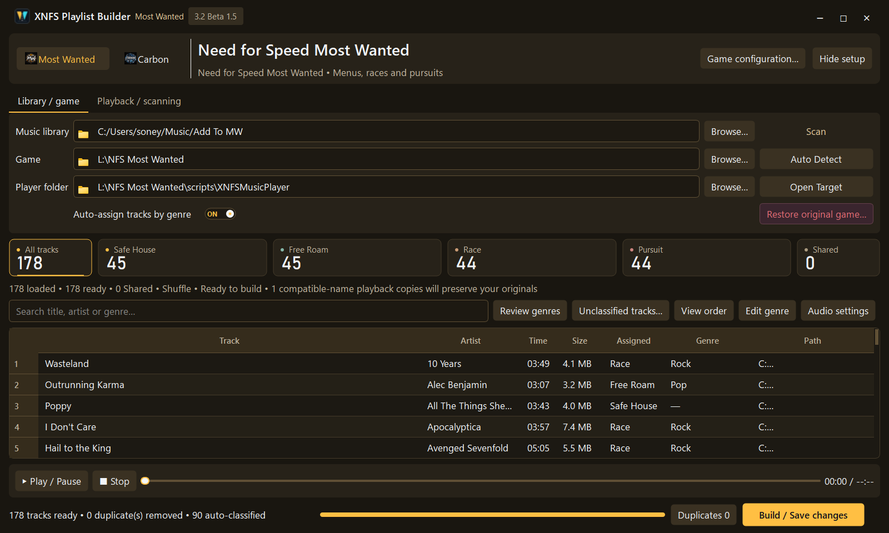](beta-1.5/most-wanted/01-library.png) | [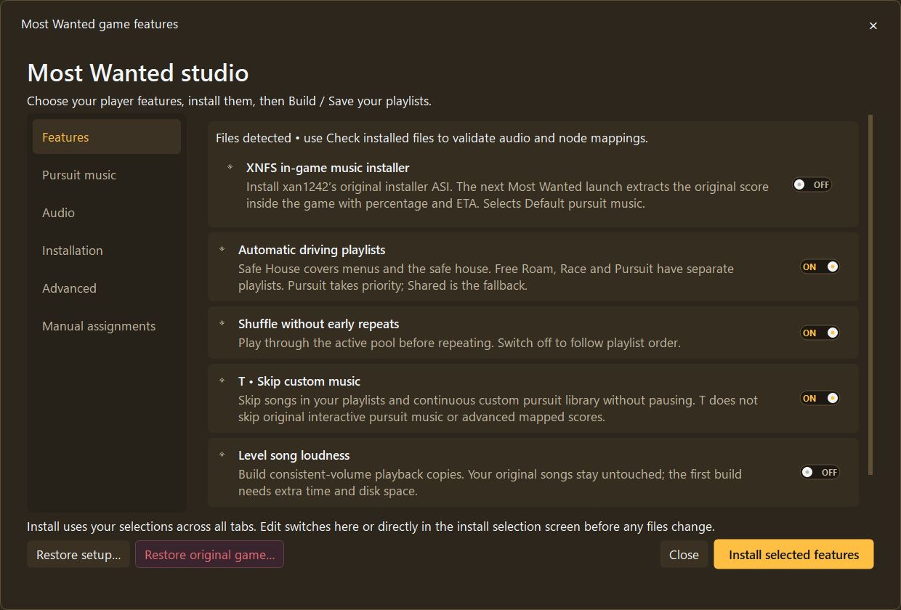](beta-1.5/most-wanted/04-features.png) |
| [**Library, tracks and categories**](beta-1.5/most-wanted/01-library.png) | [**Features and player options**](beta-1.5/most-wanted/04-features.png) |
| [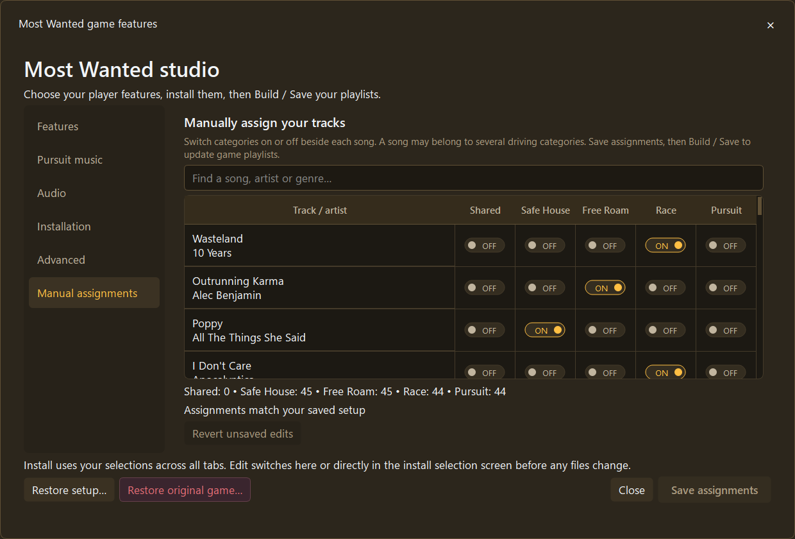](beta-1.5/most-wanted/17-manual-assignments.png) | [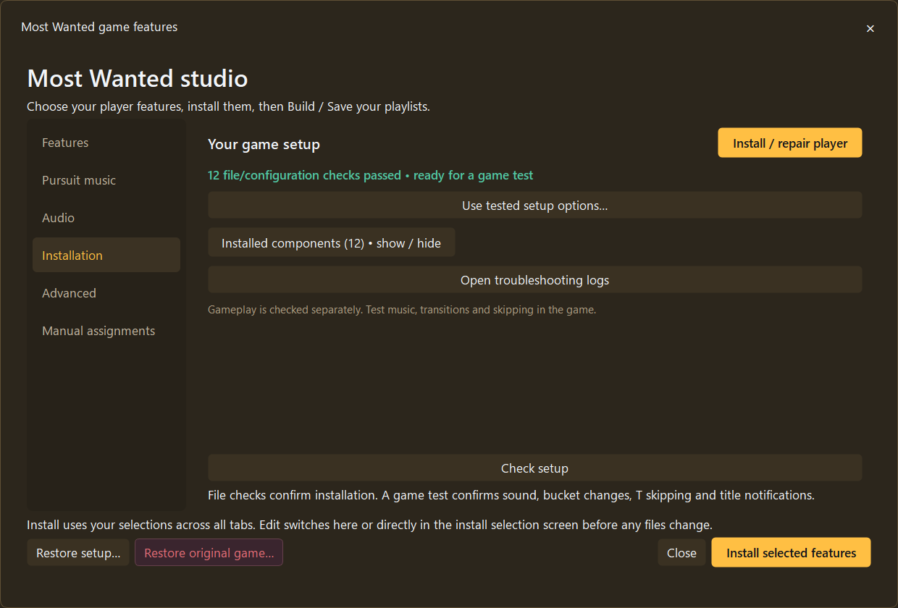](beta-1.5/most-wanted/05-installation.png) |
| [**Manual per-song assignments**](beta-1.5/most-wanted/17-manual-assignments.png) | [**Installation manager**](beta-1.5/most-wanted/05-installation.png) |

### Most Wanted playlist and pursuit screens

| Safe House and menus | Free Roam | Race | Pursuit |
| :---: | :---: | :---: | :---: |
|  | [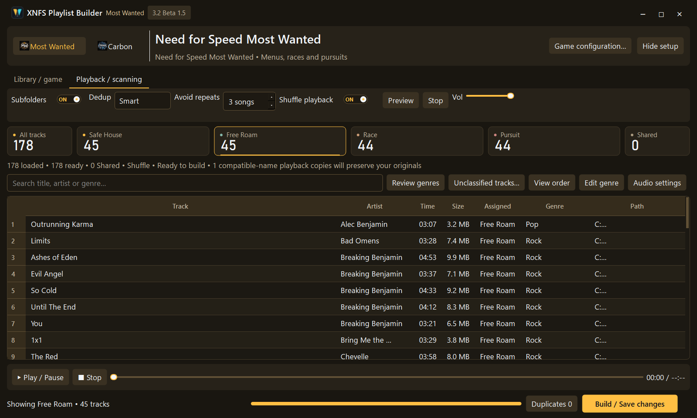](beta-1.5/most-wanted/03-freeroam.png) | [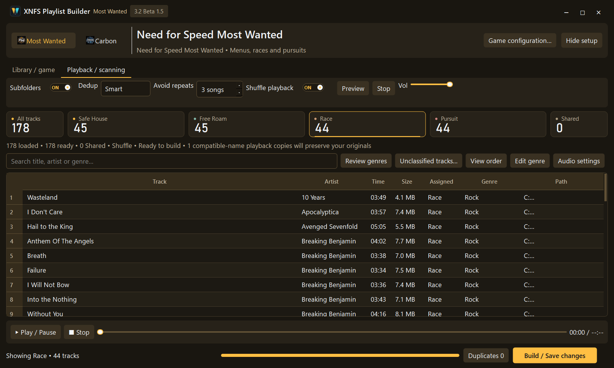](beta-1.5/most-wanted/03-race.png) | [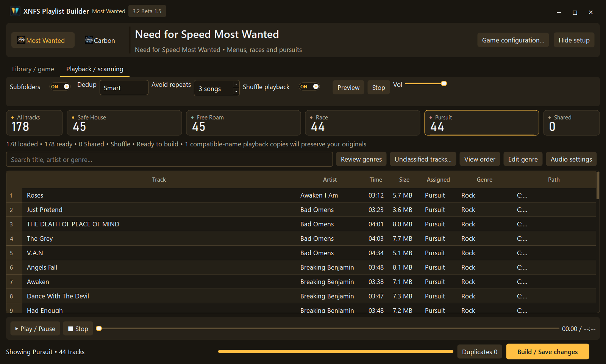](beta-1.5/most-wanted/03-pursuit.png) |

<strong>See 16 more Most Wanted screens: custom pursuit, advanced mapping, audio, setup and restore</strong>

| Screenshot | What you are looking at |
| --- | --- |
| [Library setup](beta-1.5/most-wanted/02-library-setup.png) | Game and music folders |
| [Scanning / playback](beta-1.5/most-wanted/02-playback-scanning.png) | Scanned library and preview |
| [All tracks](beta-1.5/most-wanted/03-all.png) | Combined category filter |
| [Pursuit options](beta-1.5/most-wanted/05-pursuit.png) | Original/default vs custom controls |
| [Custom pursuit](beta-1.5/most-wanted/11-custom-pursuit.png) | Custom music configuration |
| [Custom song selector](beta-1.5/most-wanted/15-custom-song-selector.png) | Library track selection |
| [Mapped score editor](beta-1.5/most-wanted/16-mapped-score-editor.png) | Experimental advanced nodes |
| [Advanced configuration](beta-1.5/most-wanted/05-advanced.png) | Optional editing tools |
| [Audio options](beta-1.5/most-wanted/05-audio.png) | Music preferences |
| [Category summary](beta-1.5/most-wanted/06-category-summary.png) | Playlist assignment counts |
| [Playback order](beta-1.5/most-wanted/07-playback-order.png) | Ordering controls |
| [Genre editor](beta-1.5/most-wanted/08-genre-editor.png) | Review metadata |
| [Installation details](beta-1.5/most-wanted/12-installation-details.png) | Player/component checks |
| [Selection review](beta-1.5/most-wanted/14-install-selection-review.png) | Choices before installation |
| [Restore backup](beta-1.5/most-wanted/09-restore-backup.png) | Return to saved setup |
| [Restore original](beta-1.5/most-wanted/10-restore-original.png) | Preview tracked rollback |

**Important:** T skips continuous/custom songs, **not** the original native interactive score. The new Beta 1.5 pursuit configuration remains subject to full-gameplay transition/overlap tests. [Read Most Wanted's current status](../docs/MOST-WANTED.md).

## 🔵 Carbon: Midnight Cyan

| Full library | Player features |
| :---: | :---: |
| [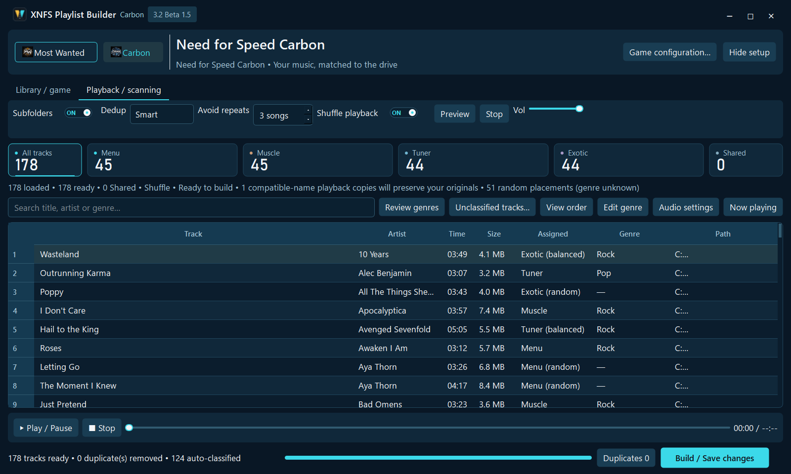](beta-1.5/carbon/01-library.png) | [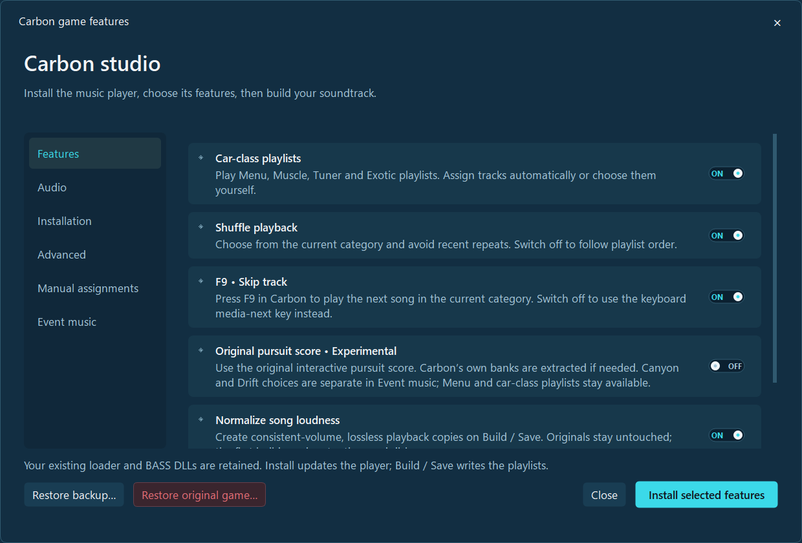](beta-1.5/carbon/04-features.png) |
| [**Library, tracks and categories**](beta-1.5/carbon/01-library.png) | [**Configurable player features**](beta-1.5/carbon/04-features.png) |
| [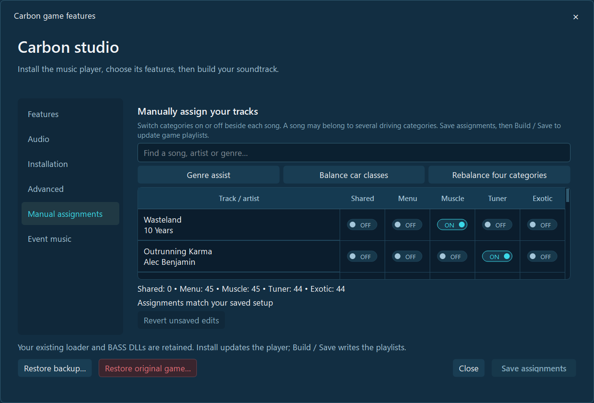](beta-1.5/carbon/17-manual-assignments.png) | [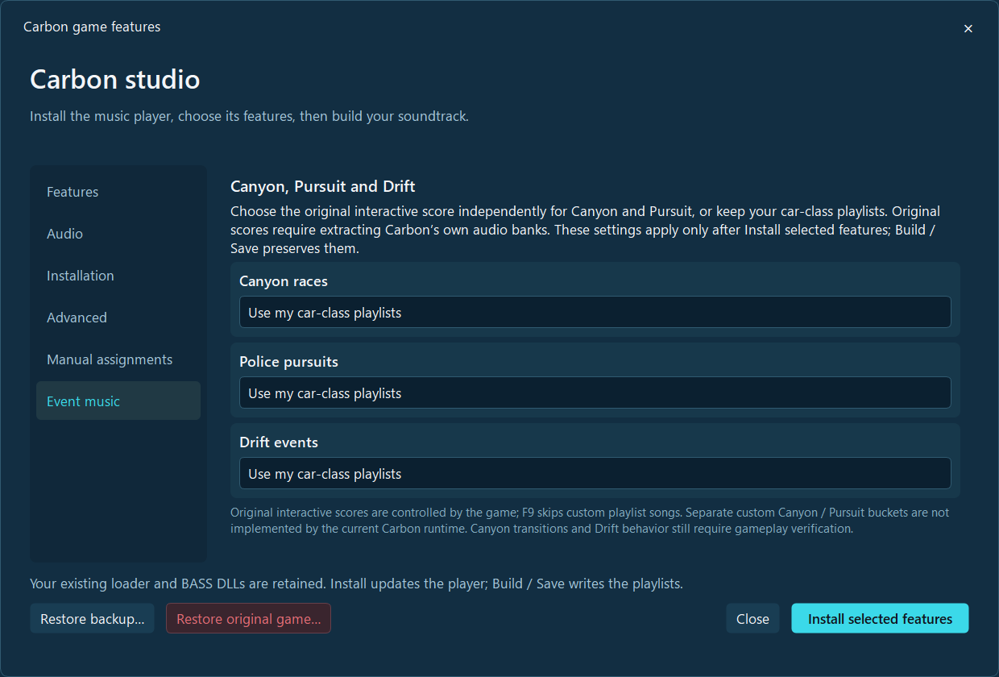](beta-1.5/carbon/18-event-music.png) |
| [**Manual track assignment**](beta-1.5/carbon/17-manual-assignments.png) | [**Experimental event music**](beta-1.5/carbon/18-event-music.png) |

### Carbon car-class categories

| Menu | Muscle | Tuner | Exotic |
| :---: | :---: | :---: | :---: |
| [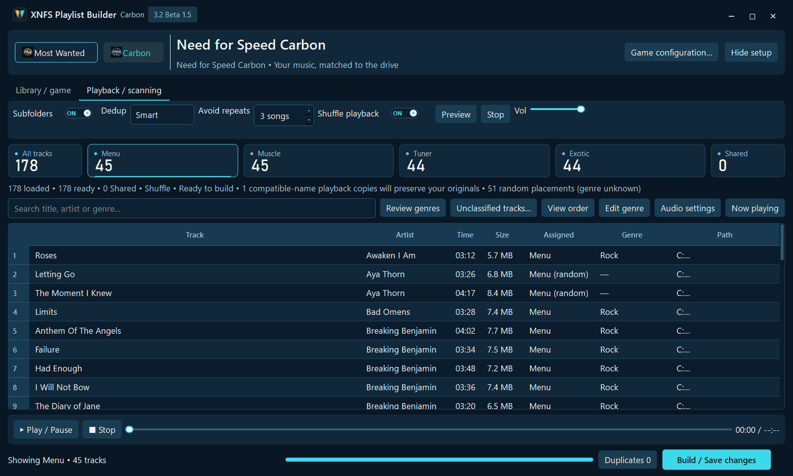](beta-1.5/carbon/03-menu.png) | [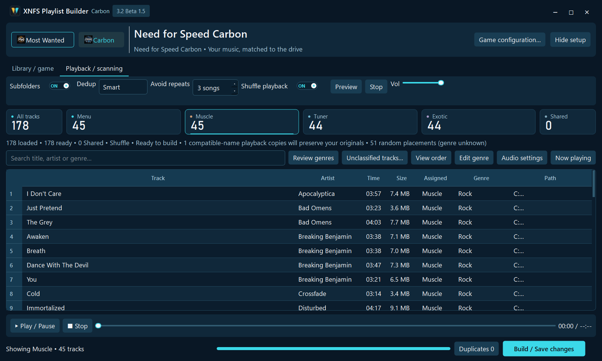](beta-1.5/carbon/03-muscle.png) | [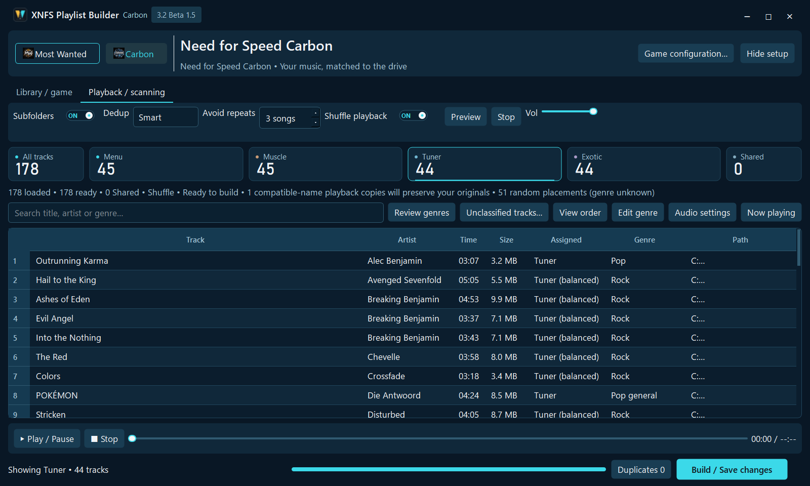](beta-1.5/carbon/03-tuner.png) | [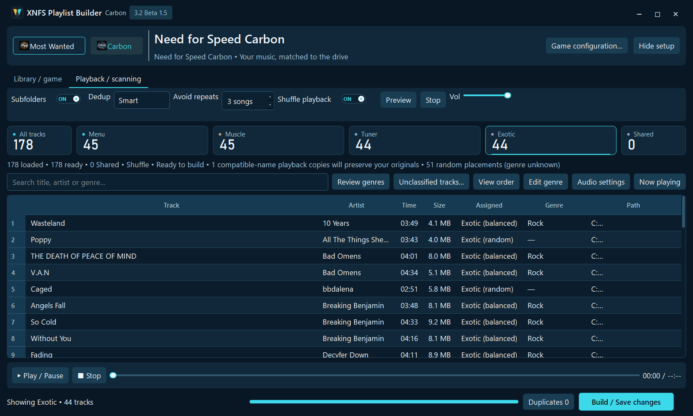](beta-1.5/carbon/03-exotic.png) |

<strong>See 13 more Carbon screens: installation, crew audio, categories and restoration</strong>

| Screenshot | What you are looking at |
| --- | --- |
| [Library setup](beta-1.5/carbon/02-library-setup.png) | Game and music paths |
| [Scanning / playback](beta-1.5/carbon/02-playback-scanning.png) | Scanned library and preview |
| [All categories](beta-1.5/carbon/03-all.png) | Combined category filter |
| [Advanced features](beta-1.5/carbon/05-advanced.png) | Experimental extraction options |
| [Audio and crew](beta-1.5/carbon/05-audio.png) | Crew-speech settings |
| [Installation page](beta-1.5/carbon/05-installation.png) | Player setup status |
| [Category summary](beta-1.5/carbon/06-category-summary.png) | Category counts |
| [Playback order](beta-1.5/carbon/07-playback-order.png) | Playlist ordering |
| [Genre editor](beta-1.5/carbon/08-genre-editor.png) | Edit and review tags |
| [Restore backup](beta-1.5/carbon/09-restore-backup.png) | Previously backed-up setup |
| [Restore original](beta-1.5/carbon/10-restore-original.png) | Original tracked setup |
| [Installation details](beta-1.5/carbon/12-installation-details.png) | Component checks |
| [Selection review](beta-1.5/carbon/14-install-selection-review.png) | Confirm before installing |

**Important:** Carbon's separate **custom Canyon/Pursuit** playlists are **not** implemented. Original Canyon/Pursuit and Drift control settings exist, but still require gameplay testing. [Read Carbon's current status](../docs/CARBON.md).

## Older images

Earlier Beta 1.2 / 1.4 screenshots remain available in [the legacy folders](./), but **only the `beta-1.5/` gallery above depicts the current redesigned build**. We keep older images for historical reference without mixing them into the main preview.

[← Home](../README.md) · [Full Beta 1.5 test and limitation list](../docs/WHATS-NEW-BETA-1.5.md)
