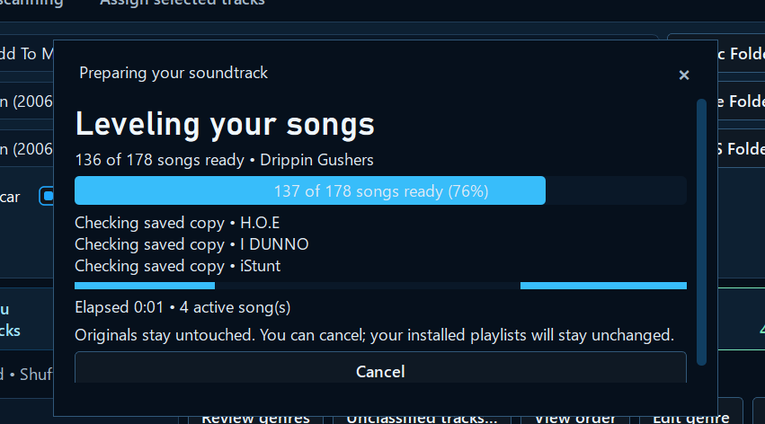
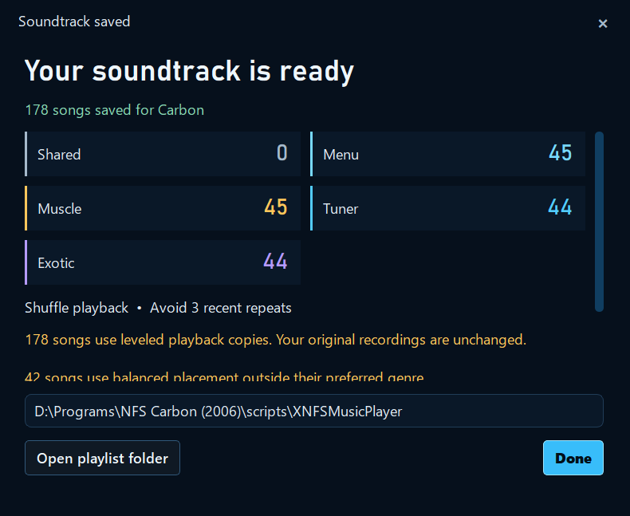
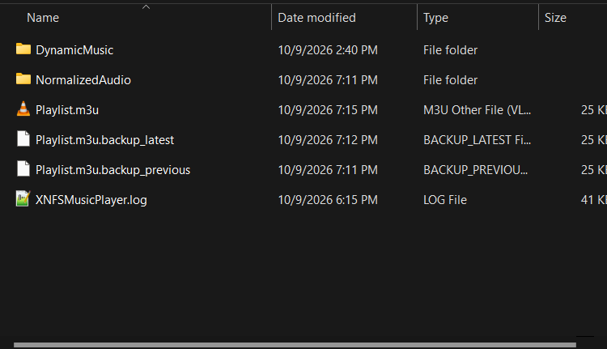

# 📷 Take a tour of XNFS Playlist Builder

Here are **six screenshots from Beta 1.2** on the developer's Windows PC. They show what the application looks like and how the main steps fit together.

[**⬇️ Download the app**](https://github.com/ValentineBSAA/XNFS-Playlist-Builder-/releases/download/v3.0-beta.1.2/XNFS-Playlist-Builder-3.0-Beta-1.2-Public.zip) · [**🚀 Easy setup guide**](../docs/GETTING-STARTED.md) · [← Home](../README.md)

## 1. Choose your game and organize your songs

### 🔵 Carbon

Pick songs for **Menu**, **Muscle**, **Tuner**, and **Exotic**. Carbon also has extra in-game playback options.

### 🟡 Most Wanted (2005)

**Most Wanted works today** for creating and saving custom playlists. Automatic transitions between game situations are still being developed.

## 2. Choose optional Carbon features

Turn optional Carbon options on or off before you install them.

## 3. Watch your music being prepared

If you choose audio leveling, the builder shows progress while preparing separate playback copies. Your original songs stay unchanged.

## 4. See the finished result

See how many songs were saved in each playlist.

## 5. Your saved playlists and backups

The builder writes playlists for the player and keeps compatible backup records.

> These are screenshots from one local PC. They're not a promise that every game version or modded setup has been tested.

[← Home](../README.md)
