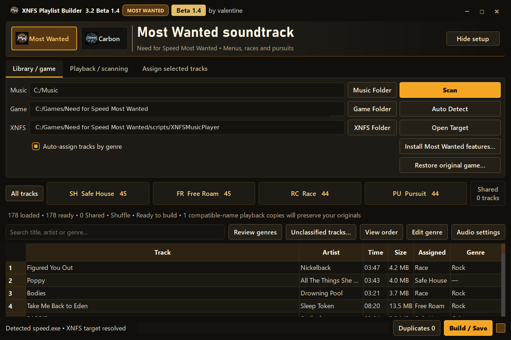
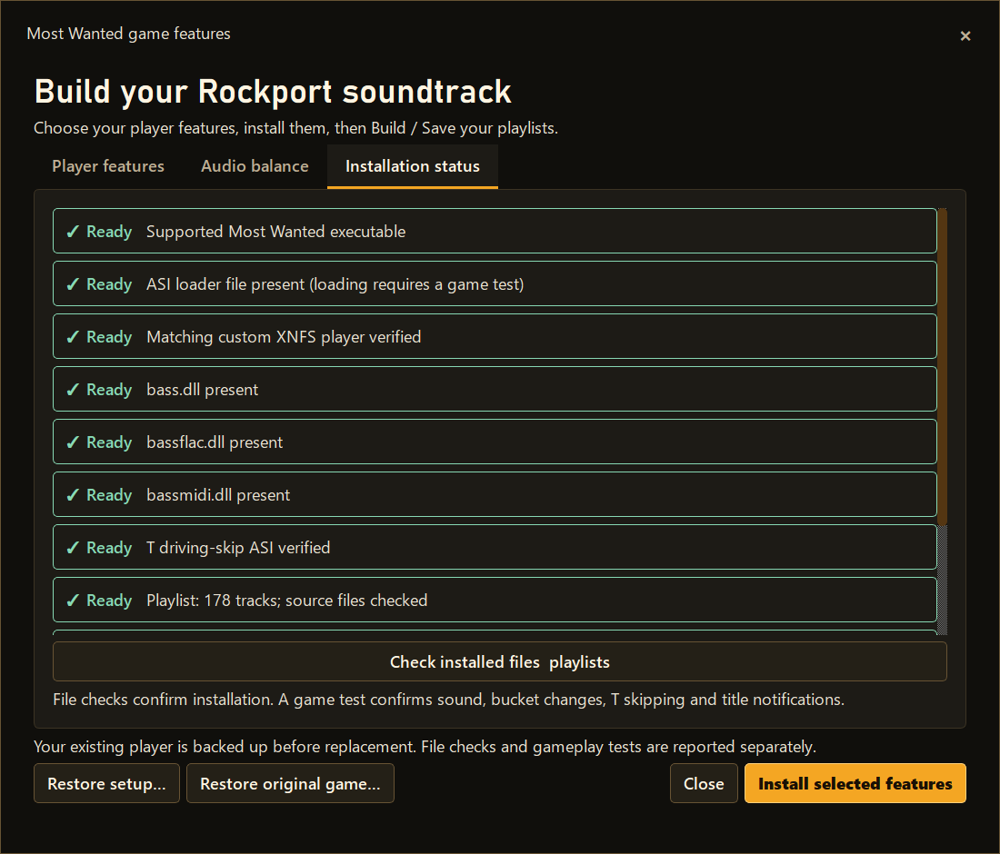
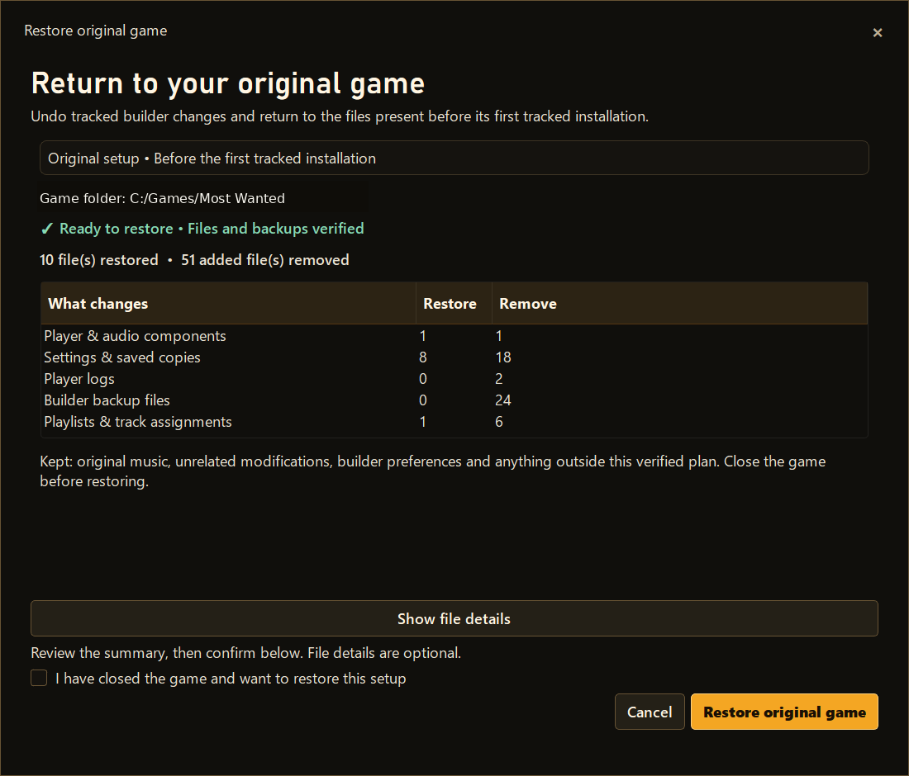
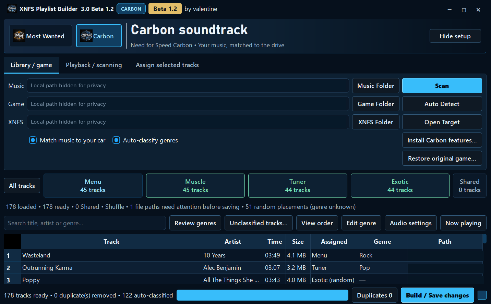
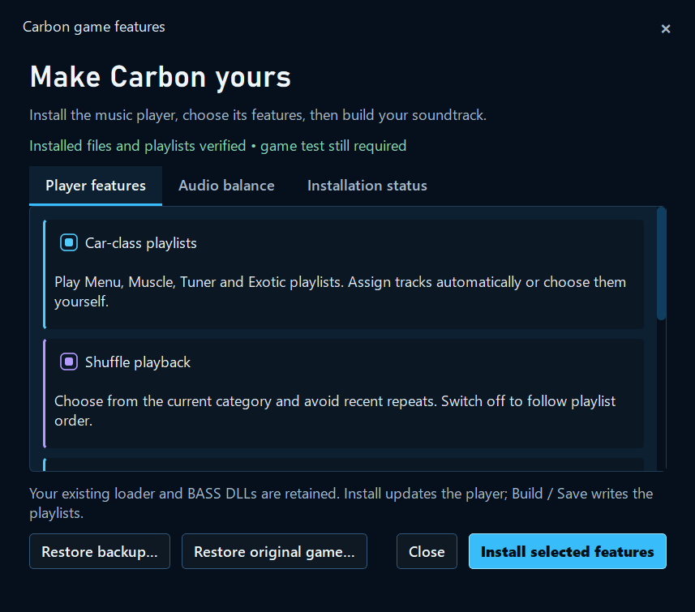

# 📷 Real XNFS Playlist Builder screenshots

Screens are organized by game, with shared features shown separately. Click any picture to view it full-size.

[← Home](../README.md) · [⬇️ Download Beta 1.4](https://github.com/ValentineBSAA/XNFS-Playlist-Builder-/releases/download/v3.2-beta.1.4/XNFS-Playlist-Builder-3.2-Beta-1.4-Clean-Public.zip) · [First-time guide](../docs/GETTING-STARTED.md)

## 🟡 Most Wanted (2005), new Beta 1.4 screenshots

### 1. Your music library

Safe House includes menus; Free Roam, Race and Pursuit have their own playlist categories. **Important:** The Pursuit category is shown in this screenshot, but **the full interactive pursuit-music system was never implemented in public Beta 1.4**. The updated implementation is still in development for **Beta 1.5**, which is not ready for release. **The Beta 1.4 download is unchanged.** [Read the public known-issue notice](https://github.com/ValentineBSAA/XNFS-Playlist-Builder-/issues/2).

### 2. Choose your playback options

Configure available driving-music options, skipping, shuffle and other supported features. **A visible option is not proof that its underlying feature has been fully implemented or tested**; see the [Beta 1.4 known issue](../docs/WHATS-NEW-BETA-1.4.md#known-issue-interactive-pursuit-music).

### 3. Check installation status

Review player installation and compatibility checks.

### 4. Restore your original setup

See the restore options and tracked changes before restoring.

**[Read the Most Wanted game guide →](../docs/MOST-WANTED.md)**

See the older Most Wanted Beta 1.2 interface

This is a historical screenshot, not Beta 1.4.

## 🔵 Carbon (2006), earlier Beta 1.2 screenshots

### 1. Your Carbon soundtrack

Your music follows Menu, Muscle, Tuner and Exotic categories.

### 2. Choose Carbon features

Review optional playback features such as F9 skipping and music ducking.

**[Read the Carbon game guide →](../docs/CARBON.md)**

## 🎵 Shared application features

See music leveling, save summaries and saved files

### Preparing leveled music

### Confirming your saved soundtrack

### Your saved playlists and files

These shared screenshots were captured with the earlier Beta 1.2 interface.

*Screenshots show the developer's Windows application, not proof that every supported setup has been tested. Full interactive pursuit music was never implemented in Beta 1.4. The newest Most Wanted combined menu/Safe House behavior still needs another in-game acceptance test.*

[← Home](../README.md)
